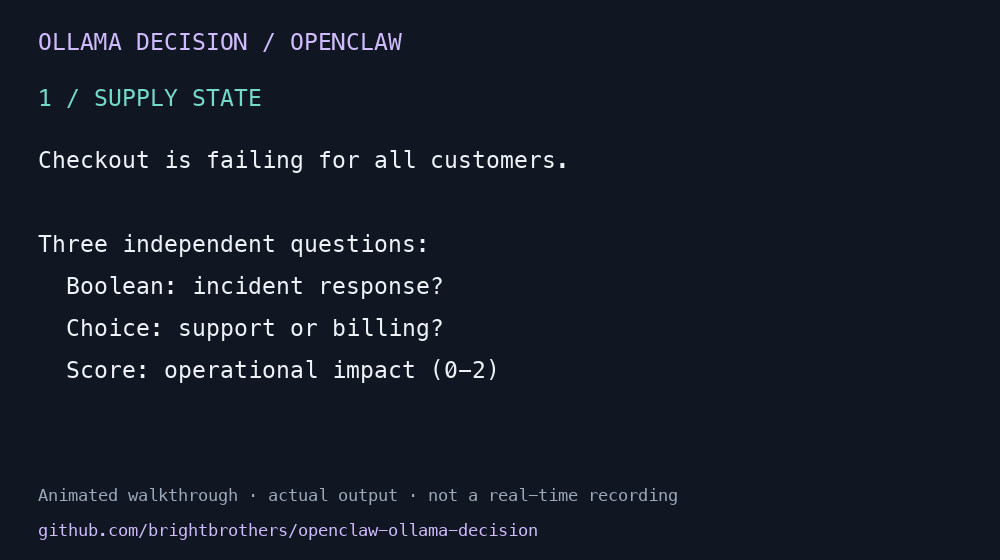

# Ollama Decision for OpenClaw

Classify requests, choose among alternatives and score a rubric with a local AI
Decision model, while keeping your OpenClaw chat model unchanged.

A community plugin that connects **tev1:0.8b** and **tev1:4b**, running locally in Ollama,
to OpenClaw's **Decision model** role. Zero runtime dependencies; plain ESM.

- Provider: `ollama-decision`
- Decision model selectors: `ollama-decision/tev1:0.8b` and
  `ollama-decision/tev1:4b`
- Endpoint: `http://127.0.0.1:11434/v1/systemone`
- Supports Boolean, Choice and Score questions.

This is an independent community project, not an official OpenClaw or Ollama plugin.
It does not replace your conversational model.



The animation uses a real captured `decision_evaluate` result from Tev1 0.8B.
It is an edited walkthrough, not a real-time recording.
[Reproduce the example and inspect the captured output](docs/example.md).

## Requirements and compatibility

- Node.js 22 or newer.
- OpenClaw with `api.registerDecisionProvider`, Decision provider contract v1,
  and manifest `decisionModels` support. Integration was verified on OpenClaw
  **2026.9.8** (runtime loading, model catalog and a real `decision_evaluate` batch).
  Older releases and every future release are not independently verified.
- Ollama **0.35 or newer**, with **POST `/v1/systemone`** and at least one
  supported model. A working `/api/chat` endpoint alone is insufficient.

The model publisher requires [Ollama 0.35+](https://ollama.com/library/tev1).
Actual checks performed on 2026-10-11 used Ollama **0.40.2** and Node **24.18.0**:

| Model | Adapter smoke: Boolean / Choice / Score | OpenClaw runtime |
| --- | --- | --- |
| `tev1:0.8b` | Passed locally | Previously verified on 2026.9.8; real `decision_evaluate` call repeated on 2026-10-11 using installed v0.1.0 |
| `tev1:4b` | Passed locally with v0.2.0 | Declared in manifest; 4B host/picker integration not independently rerun |

These are connectivity and response-shape checks, not an accuracy or speed benchmark.
The package declares the exact historically verified host API version, 2026.9.8.
Other host versions require their own compatibility check.
This is not a generic Ollama chat provider.

## Install

Start your local Ollama service, then download the model if needed:

```sh
ollama pull tev1:0.8b
# Or select the larger model:
ollama pull tev1:4b
```

Clone and review the plugin, run the tests, then install from the local checkout:

```sh
git clone https://github.com/brightbrothers/openclaw-ollama-decision.git
cd openclaw-ollama-decision
npm test
openclaw plugins install .
```

OpenClaw may ask you to trust this community source and approve its declared
capabilities. Review those prompts. If the plugin is not enabled after installation:

```sh
openclaw plugins enable ollama-decision
openclaw plugins inspect ollama-decision --runtime --json
```

In OpenClaw's **Decision** model picker, select either
`ollama-decision/tev1:0.8b` or `ollama-decision/tev1:4b` for the intended agent.
The 4B selector is useful when you want to try a larger local model for
multi-question decisions such as incident severity and routing. This release
does not claim a measured accuracy or latency improvement. Leave the chat-model
picker unchanged.
Alternatively, merge the relevant fields into your existing config:

```json
{
  "plugins": {
    "entries": {
      "ollama-decision": {
        "enabled": true,
        "config": { "baseURL": "http://127.0.0.1:11434" }
      }
    }
  },
  "agents": {
    "defaults": { "decisionModel": "ollama-decision/tev1:4b" }
  }
}
```

The defaults field affects agents inheriting it; use an agent-specific Decision
selection to limit scope. Do not replace your whole config with this snippet.

## Test

```sh
npm test        # mocked unit tests; no Ollama or OpenClaw required
npm run smoke   # synthetic incident-triage batch; defaults to 0.8b / 20 seconds
npm run smoke -- --model tev1:4b --timeout-ms 30000
```

The smoke CLI accepts the exact selectors `tev1:0.8b` and `tev1:4b`, plus a
positive timeout from 1 to 300000 milliseconds. It prints the requested model,
timeout and outcome, and writes the same evidence to `smoke-evidence.json`
(gitignored). It checks adapter connectivity and response structure, not model
accuracy. Cold model loading may exceed short Decision deadlines; pre-warm with
the smoke script before testing time-sensitive consumers. See the
[demo recording steps](docs/demo.md).

## Mapping and limits

- Boolean maps to System One `noul`; its answer maps to `probabilityTrue`.
- Choice preserves labels and their probability map.
- Score converts canonical index keys `0..N-1` into an ordered probability array
  and preserves fractional scores.
- Rounded probabilities are preserved, not normalized; scores are not recomputed.
- Confidence is provider-specific, not a guarantee of correctness.
- 1–64 questions per batch; 2–26 Choice alternatives or Score levels.
- State must be nonempty text, an object or an array. Structured criteria are
  serialized as JSON text; null criteria are accepted only for Choice.
- Missing instructions get a neutral default. Unsupported models/input fail
  before dispatch. There is no token truncation or retry.

The provider validates answer types, exact question/distribution keys, labels,
finite numeric ranges and usage counters. Request/response bodies are limited to
1 MiB. Caller cancellation and monotonic deadlines abort network operations.
HTTP errors and invalid responses become structured unavailable outcomes.

## Locality and privacy

`baseURL` accepts only HTTP loopback origins: `localhost`, `127.0.0.1` or `[::1]`,
with an optional port. Credentials, paths, query strings, remote hosts and redirects
are rejected. This plugin has no API keys, telemetry, prompt logging or dependencies.
Submitted state and criteria are sent to your local Ollama endpoint; that service's
own behavior and logging are outside this plugin's control.

`isReady()` means the plugin needs no credentials. It does **not** probe Ollama or
prove that the model is loaded. Connectivity is established by evaluation.

If Node is configured to use an environment proxy, ensure loopback requests bypass
it (for example using `NO_PROXY=localhost,127.0.0.1,::1 npm run smoke`). An environment that still proxies
localhost can yield a transport-unavailable outcome.

## Integration boundary

Selecting this model makes explicit Decision calls available to supported OpenClaw
consumers. It does **not** itself enable automatic tool filtering, memory selection,
model routing or background jobs. Automatic consumers depend on your OpenClaw
release, experimental-feature settings and runtime harness. Codex-harness tool
prefiltering is not provided by this plugin.

## Runnable example and release material

The smoke command is a runnable synthetic incident-triage example: it assesses
whether a checkout outage needs escalation, routes it to a team, and scores its
operational impact. It sends synthetic text only. See [promotion drafts and
release material](docs/promotion.md) for prepared, unpublished copy.

## Troubleshooting

- `transport`: check that Ollama is running and loopback bypasses any environment proxy.
- `unsupported-input`: pull the exact selected Tev1 model, confirm System One support, and check batch limits.
- A deadline error: pre-warm the model or use a longer smoke deadline; the plugin preserves host deadlines.
- No Decision picker: check your OpenClaw version and Decision provider API support.

## Contributing

See [CONTRIBUTING.md](CONTRIBUTING.md). Bugs and compatibility reports are welcome.
Please use synthetic examples and remove personal data and credentials from reports.

## License

MIT. See [LICENSE](LICENSE). Ollama, OpenClaw and model weights retain their own licenses.
